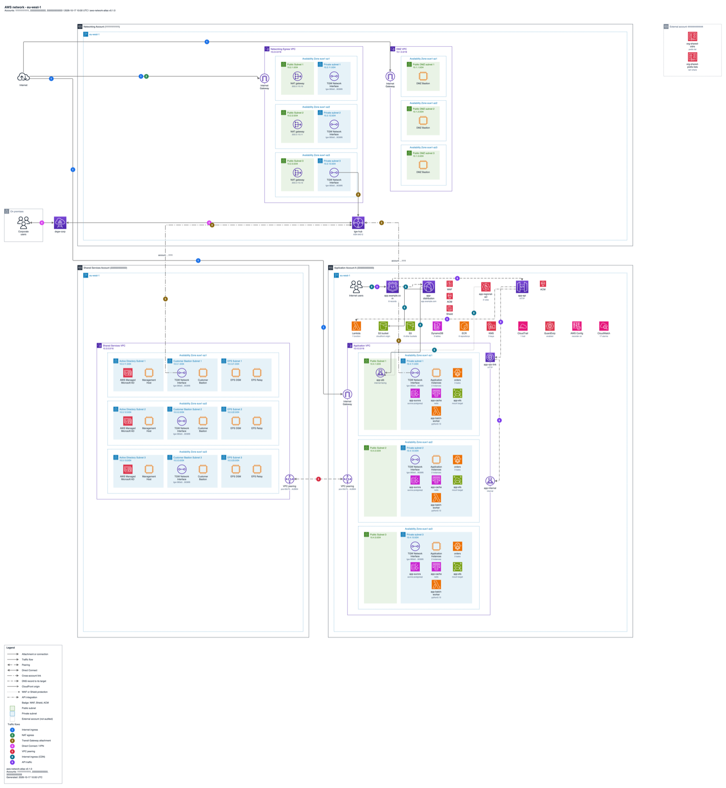

<div align="center">

# Hi, I'm Karina

**Cloud engineer in Spain. I build tools that make AWS networks visible.**

[karina-perez.es](https://karina-perez.es) · [vpcatlas.com](https://vpcatlas.com) · [Documentation](https://vpcatlas.com/docs/) · [mail@karina-perez.es](mailto:mail@karina-perez.es)

</div>

## VPC Atlas

Read-only AWS network discovery from the command line. One command connects to an account with auditor
permissions, maps its whole network and the accounts linked to it, and writes three things:

- **An inventory** in JSON, Markdown and HTML, with a section for every external account that is linked to yours.
- **Architecture diagrams** in draw.io and Lucidchart with the AWS Architecture Icons look, laid out like the
  AWS multi-account landing zone network reference: a global page, a page per Region and one per VPC.
- **A live dashboard** that refreshes the diagrams on a schedule and exports them.

Cross-account links are part of the picture: Transit Gateways shared through RAM, VPC peering with accounts you
do not own, endpoints and Resolver rules shared with you. Nothing is created, changed or deleted in AWS.

<p align="center">
  <a href="https://vpcatlas.com"></a>
</p>

### Try it

```sh
# macOS / Linux
curl -fsSL https://vpcatlas.com/install.sh | sh

# Windows
irm https://vpcatlas.com/install.ps1 | iex

# Scan two Regions with a profile, then open the dashboard
vpcatlas discover --profile audit --regions eu-west-1,us-east-1 --output-dir ./out --format all
vpcatlas serve
```

Also on [Docker Hub](https://hub.docker.com/r/vpcatlas/vpcatlas) (`vpcatlas/vpcatlas`), with guides to run the
dashboard on Docker, ECS, Kubernetes or Lambda. The minimal read-only IAM policy comes with the tool:
`vpcatlas iam-policy`.

- Source: [karina-pp/vpcatlas](https://github.com/karina-pp/vpcatlas) · [Releases](https://github.com/karina-pp/vpcatlas/releases) · [Changelog](https://vpcatlas.com/docs/changelog/)
- Docs: [Install](https://vpcatlas.com/docs/install/) · [Quickstart](https://vpcatlas.com/docs/quickstart/) · [Credentials](https://vpcatlas.com/docs/credentials/) · [Coverage](https://vpcatlas.com/docs/coverage/)

## What I work with

| | |
|---|---|
| **Cloud** | AWS: networking (VPC, Transit Gateway, PrivateLink, Direct Connect), IAM, CloudFront, ECS, EKS, Lambda |
| **Infrastructure as code** | Terraform, GitHub Actions |
| **Languages** | Python, Bash, PowerShell |
| **Diagrams** | draw.io, Lucidchart, the AWS Architecture Icons |

## Elsewhere

- Website: [karina-perez.es](https://karina-perez.es)
- Mail: [mail@karina-perez.es](mailto:mail@karina-perez.es)
